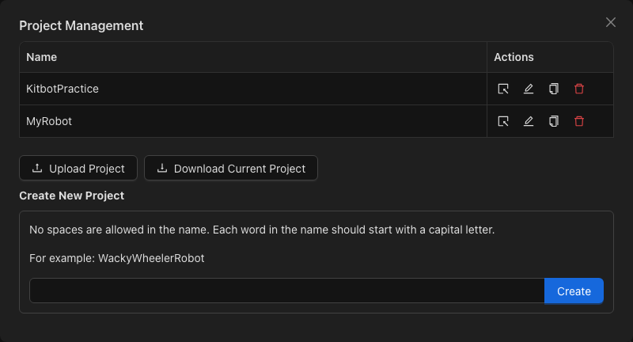
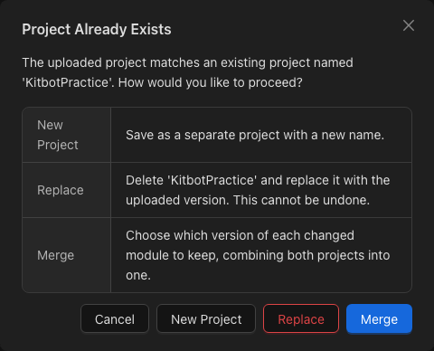

Back Up and Restore a Blocks Project
====================================

In this tutorial, you will download an editable project backup and restore it as a separate project. Use the drivetrain project you created from :doc:`first-project`.

Download Your Project
---------------------

1. Stop editing and allow the automatic save to finish. The editor schedules an automatic save after five seconds without another change.
2. Open :menuselection:`Manage --> Projects...`.
3. Select :guilabel:`Download Current Project`.
4. Locate the downloaded ``.blocks`` backup. Its filename is based on your project name.

   Use Download Current Project to save an editable backup.

The ``.blocks`` file contains the editable project. Keep this file when you want to back up your blocks or share the project with another student. Copying text from the Python preview does not create an editable Blocks backup.

Restore a Separate Copy
-----------------------

1. In :menuselection:`Manage --> Projects...`, select :guilabel:`Upload Project`.
2. Choose the ``.blocks`` backup you downloaded.
3. If the :guilabel:`Project Already Exists` dialog appears, choose :guilabel:`New Project` to keep a separate copy.
4. When asked for a project name, enter a new name such as ``KitbotRestored`` and complete the upload.
5. Select the restored project from the project list if it is not already open.
6. Open Teleop and check the blocks and generated Python against your original project.

   Choose New Project to restore the backup as a separate copy.

Check Your Work
---------------

Confirm that the original and restored projects both appear in the project list. Open each and check that CANDriveSubsystem and Teleop contain your drivetrain and driver-control blocks.

Keep a downloaded backup before moving to another computer or changing where you open Blocks. A project in one storage location may not appear in another.

