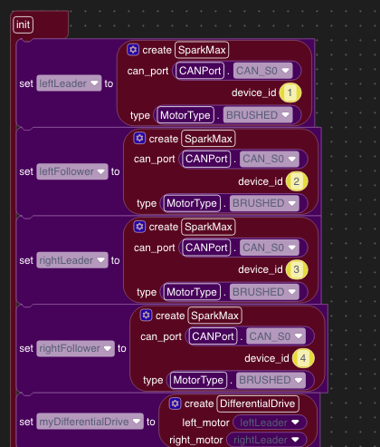
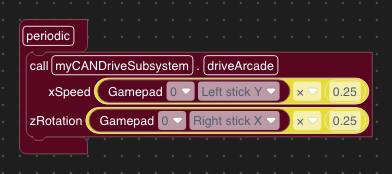

Drive Your KitBot with Blocks
=============================

Build a program to drive a four-motor KitBot with CIM motors and REV SPARK MAX controllers over CAN. You will create the drivetrain, connect the gamepad inputs, and test the robot.

.. important::

   This tutorial is a draft. The screenshots use the local Blocks editor with a REV library that includes SPARK support. The generated Python and hardware operation still need to be verified on the robot.

Before You Start
----------------

Complete the control-system preparation in :doc:`Zero to Robot Step 3 </docs/zero-to-robot/step-3/index>`. Follow the robot and controller manufacturers' wiring instructions. Have the following ready:

* A KitBot drivetrain with four CIM motors, two on each side.
* Four SPARK MAX controllers configured for brushed motors, with unique CAN device IDs.
* A supported Systemcore installation with Blocks and compatible REV robot libraries.
* Driver Station communication with the robot and a connected gamepad.
* A secure support that keeps every drive wheel clear of the floor, and a clear test area.

Create Your Project
-------------------

Open Blocks from the Systemcore web dashboard. In :menuselection:`Manage --> Projects...`, create a new project named ``KitbotPractice``.

Use Robot for the robot setup, a mechanism named ``CANDriveSubsystem`` for the drivetrain, and Teleop for the driver controls. This project only needs the four drive motors and the gamepad inputs used below.

Build the Drivetrain
--------------------

Follow :doc:`kitbot-drivetrain` to add the motor controllers, set up the followers, and create the ``driveArcade`` method. Add an instance of CANDriveSubsystem named ``myCANDriveSubsystem`` to Robot.

Match the Four Motor Controllers
--------------------------------

In CANDriveSubsystem, add the four motor controllers to ``init``. Use the following CAN IDs if they match your robot:

.. list-table:: Drivetrain controller assignments
   :header-rows: 1
   :widths: 25 15 15 45

   * - Variable
     - CAN bus
     - Device ID
     - Connection
   * - ``leftLeader``
     - 0
     - 1
     - Left drive motor
   * - ``leftFollower``
     - 0
     - 2
     - Other left drive motor
   * - ``rightLeader``
     - 0
     - 3
     - Right drive motor
   * - ``rightFollower``
     - 0
     - 4
     - Other right drive motor

   Add one controller for each drive motor. Select CANPort.CAN_S0 for Systemcore CAN bus 0 and MotorType.BRUSHED for CIM motors.

Set physical controller IDs using the supported REV hardware configuration tool, or change the blocks' IDs to match your documented wiring. Power-distribution channel numbers are not CAN IDs.

Check that leftFollower follows leftLeader and rightFollower follows rightLeader. Check motor inversion with the robot raised so both sides move in the intended direction.

See :doc:`kitbot-drivetrain` for a block-by-block explanation of controller configuration, followers, and the drive method.

Connect the Driver Controls
---------------------------

1. Connect the gamepad to the driver computer and confirm its port in Driver Station.
2. In the Teleop toolbox, open Driver Station, then Gamepads, and select :guilabel:`Configure Gamepads`.
3. Set gamepad port 0 to the controller type you are using, then save the settings.
4. Add a call to ``myCANDriveSubsystem.driveArcade`` in Teleop's ``periodic`` block.
5. Connect ``xSpeed`` to Gamepad 0 Left stick Y and ``zRotation`` to Gamepad 0 Right stick X.

Check axis readings and motor direction before deciding whether to negate an axis. Leave the other gamepad buttons unconnected for this tutorial.

Reduce the Initial Drive Requests
---------------------------------

Before a powered test, reduce both inputs to the driveArcade call:

1. From Math, put a multiplication block between the Left stick Y block and ``xSpeed``. Multiply the axis reading by ``0.25``.
2. Add another multiplication block between the Right stick X block and ``zRotation``. Multiply that reading by ``0.25`` too.
3. Check that both multiplications are connected inside the driveArcade call and that the call remains inside ``periodic``.

   Read the two gamepad axes each cycle and reduce both requests for the initial drive test.

This reduces the requested forward and turn inputs; it is not a guaranteed motor-output cap or safe speed. With squared inputs enabled in DifferentialDrive, joystick request scaling and motor output are not identical.

Resolve Compatibility Before Deployment
---------------------------------------

Check for warnings on the motor-controller and DifferentialDrive blocks. Confirm that the generated Python uses the classes and methods available in your installed robot libraries. Resolve any missing or unrecognized calls before deploying.

If a block says it gets a value from an "enum that no longer exists," the editor cannot find that enum in its loaded library definitions. This message can indicate missing library support as well as a changed API.

For this project, check for ``rev.SparkLowLevel.MotorType``, ``rev.ResetMode``, and ``rev.PersistMode``. Open :menuselection:`Manage --> Libraries...` and check that the installed REV library includes SPARK MAX controllers and their configuration blocks. A REV library that provides only A301 motors and color sensors does not provide the SPARK definitions this project needs. Installing that library alone will not resolve these warnings.

Use a compatible library that provides the SPARK controller, configuration, and enum definitions together. If none is available for your editor version, this tutorial cannot yet be completed with that installation. Replacing the enum blocks with numbers or text does not restore the missing controller APIs.

Save an editable backup using :menuselection:`Manage --> Projects...` and :guilabel:`Download Current Project` before changing APIs. See :doc:`backup-and-restore`.

Deploy the Compatible Project
-----------------------------

Continue only after the project has passed the compatibility check above.

1. Keep the robot disabled and securely supported, with every drive wheel clear and people clear of moving parts.
2. Open the project in Blocks hosted by the robot. A project saved in the local editor may need to be downloaded there and uploaded into the robot-hosted editor.
3. Check the selected project name, controller assignments, and reduced drive requests again.
4. Select :guilabel:`Deploy` in the header and wait for a success result.
5. Confirm that Driver Station communicates with the robot and reports robot code before attempting to enable it.

A disabled Deploy button in the local editor usually means the robot backend is unavailable. A successful upload or code preview is not a successful robot deployment.

Perform the First Drive Check
-----------------------------

Use Teleop for this check. Keep the sticks centered and the robot disabled while selecting the mode. Be ready to disable immediately.

1. Enable briefly with centered sticks. All drive wheels should remain stopped; disable if they move.
2. Apply a small forward request with the left stick. Both sides should move the robot in the same intended direction. Release the stick and check that the wheels stop.
3. Apply a small turn request with the right stick. Confirm that both motors on each side agree and that the direction matches the requested turn. Release the stick.
4. Check reverse movement briefly.
5. Disable the robot while making a small drive request. All drive motors must stop.

If any result is wrong, disable before adjusting code or wiring. Repeat the raised-wheel test after each change. Move to a clear floor area only after every check passes, and keep the reduced drive requests for the first floor test.

Troubleshooting
---------------

.. list-table:: First-drive problems
   :header-rows: 1
   :widths: 30 70

   * - Symptom
     - Check while disabled
   * - Controller calls show warnings
     - Check that the blocks use APIs supported by the installed robot libraries. Do not deploy until resolved.
   * - Deploy is unavailable
     - Open the robot-hosted editor and check backend connectivity.
   * - Deployment fails or robot code is missing
     - Read the deploy error and robot logs. Check the motor-controller configuration and installed libraries.
   * - No response to either stick
     - Check Teleop selection, enabled state, gamepad port 0, controller type, and the connected periodic drive call.
   * - One drive motor does not respond
     - Check its power, CAN ID, wiring, and leader/follower assignment.
   * - Motors on one side oppose each other
     - Check the follower assignment, follow inversion, and motor wiring against the physical installation.
   * - Forward or turning direction is reversed
     - Check actual axis readings and motor inversion. Change one setting at a time and retest with wheels clear.

After the First Drive
---------------------

Download a backup of the working project and record its controller IDs and direction settings. Use :doc:`decisions` to try a different driver-control layout.
