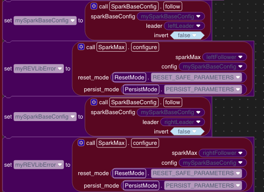
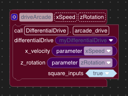

Build the KitBot Drivetrain
===========================

Build the drivetrain in CANDriveSubsystem, then connect it to the gamepad in Teleop.

Add the Motor Controllers
-------------------------

1. Open CANDriveSubsystem and find its ``init`` block.
2. Add a SPARK MAX construction block and store it in ``leftLeader``.
3. Set ``can_port`` to ``CANPort.CAN_S0`` for Systemcore CAN bus 0.
4. Set ``device_id`` to the controller's CAN ID and ``type`` to ``MotorType.BRUSHED`` for the CIM motor.
5. Repeat for ``leftFollower``, ``rightLeader``, and ``rightFollower``.
6. Check all four CAN IDs against the assignments in :doc:`first-project`. Each controller needs a unique ID.

Set Up the Followers
--------------------

Each side has a leader that receives drive commands and a follower that runs the second motor.

1. Create a ``SparkBaseConfig`` configuration and store it in a variable.
2. Set current limits appropriate for your motors and drivetrain.
3. Add a ``follow`` call on the configuration. Set ``leader`` to ``leftLeader``.
4. Call ``configure`` on ``leftFollower``. Connect the configuration variable and select ``RESET_SAFE_PARAMETERS`` and ``PERSIST_PARAMETERS``.
5. Set the configuration's ``follow`` leader to ``rightLeader``.
6. Call ``configure`` on ``rightFollower`` with that configuration and the same reset and persist options.
7. Before applying a reused configuration to either leader, call ``disable_follower_mode`` so the leader does not receive follower settings.
8. During the raised-wheel test, check motor inversion. Both motors on a side must work together, and both sides must move the robot in the requested direction.

   Set the leader, then apply the configuration to its follower.

Add DifferentialDrive
---------------------

1. In ``init``, add a DifferentialDrive construction block.
2. Connect ``leftLeader`` to ``left_motor``.
3. Connect ``rightLeader`` to ``right_motor``.
4. Store the object in ``myDifferentialDrive``.

DifferentialDrive combines forward and turn inputs. The followers run the other two motors.

Create the Drive Method
-----------------------

1. Add a method named ``driveArcade`` to CANDriveSubsystem.
2. Add an input named ``xSpeed`` for forward and reverse movement.
3. Add an input named ``zRotation`` for turning.
4. Inside the method, add an ``arcade_drive`` call on ``myDifferentialDrive``.
5. Connect the ``xSpeed`` parameter to ``x_velocity``.
6. Connect the ``zRotation`` parameter to ``z_rotation``.
7. Set ``square_inputs`` to ``true``. This reduces sensitivity near the center of the sticks while still allowing full output at the ends.

   Connect both method parameters to the arcade_drive call.

Connect Teleop
--------------

1. Open Robot.
2. Add an instance of CANDriveSubsystem named ``myCANDriveSubsystem``.
3. Open Teleop and find its ``periodic`` block.
4. Inside ``periodic``, add a call to ``myCANDriveSubsystem.driveArcade``.
5. Connect Gamepad 0 Left stick Y to a multiplication block. Multiply it by ``0.25``, then connect the result to ``xSpeed``.
6. Connect Gamepad 0 Right stick X to a second multiplication block. Multiply it by ``0.25``, then connect the result to ``zRotation``.
7. Check that the call is inside ``periodic`` so it reads the sticks every cycle.

.. figure:: images/kitbot-teleop-scaled.png
   :alt: Teleop periodic calls myCANDriveSubsystem.driveArcade with Gamepad 0 Left stick Y and Right stick X, each multiplied by 0.25.
   :width: 413

   Multiply both axis readings by 0.25 for the initial drive test.

.. note::

   Scaling the inputs reduces drive requests. It does not guarantee a particular motor output or robot speed.

Check and Save Your Work
------------------------

1. Return to :doc:`first-project` to check compatibility and deploy.
2. Follow the raised-wheel test before driving on the floor.
3. Use :doc:`backup-and-restore` to save your work before changing the controls.
