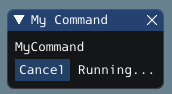
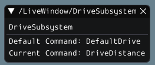
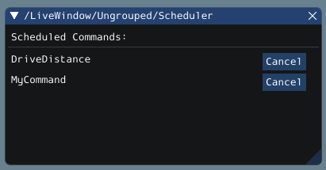

# Widgets for the Command-Based Framework

Glass provides widgets for the :doc:`Commands v2 framework </docs/software/commandbased/commands-v2/index>` to schedule commands, view subsystem status, and inspect the command scheduler. Publish editable objects through :doc:`Tunables </docs/software/telemetry/tunables>` and log read-only status through :doc:`Telemetry </docs/software/telemetry/telemetry>`. For Commands v3, see :doc:`/docs/software/commandbased/commands-v3/telemetry`.

## Command Selector Widget

The :guilabel:`Command Selector` widget lets you start and cancel a command. Keep the command as a member of your robot or container and publish it once during initialization:

.. tab-set-code::
   ```java
   import org.wpilib.tunable.Tunables;

   Tunables.publish("My Command", m_command);
   ```

   ```c++
   #include <wpi/tunables/Tunables.hpp>

   wpi::tunables::Publish("My Command", m_command);
   ```

   ```python
   import tunables

   tunables.publish("My Command", self.command)
   ```

In C++, publish the command object by reference. If it is owned by a ``CommandPtr``, publish ``*m_command`` and keep the owning ``CommandPtr`` alive.

With the default backend, open :guilabel:`NetworkTables` -> :guilabel:`Tunables` -> :guilabel:`My Command`.



When the command is not running, clicking :guilabel:`Run` schedules it. When it is running, clicking :guilabel:`Cancel` cancels it. Normal scheduler requirements and disabled-state rules still apply. Robot code must continue running the command scheduler in its periodic loop.

For display without dashboard control, log the command through Telemetry each cycle instead. It appears under ``/Telemetry`` and the widget is read-only.

## Subsystem Widget

The :guilabel:`Subsystem` widget displays a subsystem's default and currently scheduled commands. ``SubsystemBase`` implements ``TelemetryLoggable``, but does not publish itself automatically. Log the subsystem each periodic cycle:

.. tab-set-code::
   ```java
   import org.wpilib.telemetry.Telemetry;

   Telemetry.log("Drive", m_drive);
   ```

   ```c++
   #include <wpi/telemetry/Telemetry.hpp>

   wpi::telemetry::Log("Drive", m_drive);
   ```

   ```python
   import telemetry

   telemetry.log("Drive", self.drive)
   ```

Open :guilabel:`NetworkTables` -> :guilabel:`Telemetry` -> :guilabel:`Drive`.



## Command Scheduler Widget

The :guilabel:`Command Scheduler` widget displays scheduled commands. To also allow cancellation from Glass, publish the scheduler once during initialization:

.. tab-set-code::
   ```java
   import org.wpilib.command2.CommandScheduler;

   Tunables.publish("Scheduler", CommandScheduler.getInstance());
   ```

   ```c++
   #include <wpi/commands2/CommandScheduler.hpp>

   wpi::tunables::Publish("Scheduler", wpi::cmd::CommandScheduler::GetInstance());
   ```

   ```python
   from commands2 import CommandScheduler

   tunables.publish("Scheduler", CommandScheduler.get_instance())
   ```

Open :guilabel:`NetworkTables` -> :guilabel:`Tunables` -> :guilabel:`Scheduler`. To display scheduled commands without allowing cancellation, log the scheduler through Telemetry each cycle instead.


