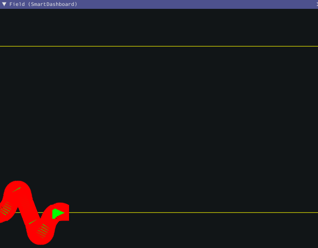
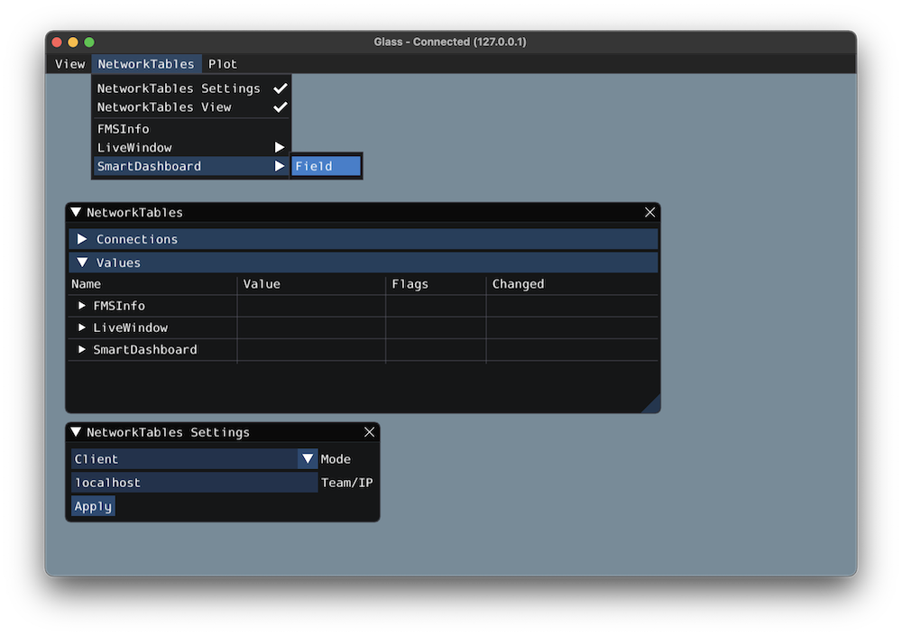
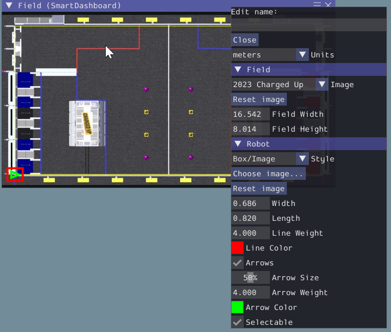
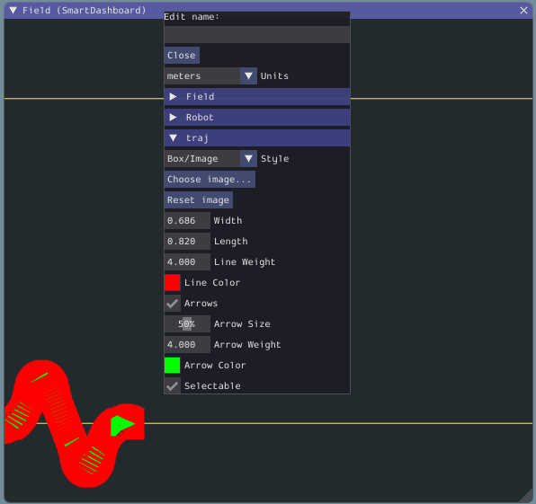
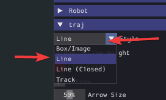
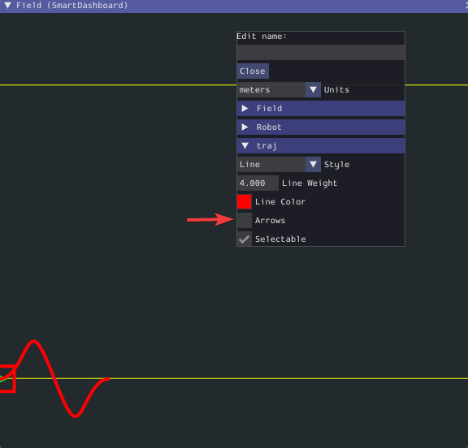
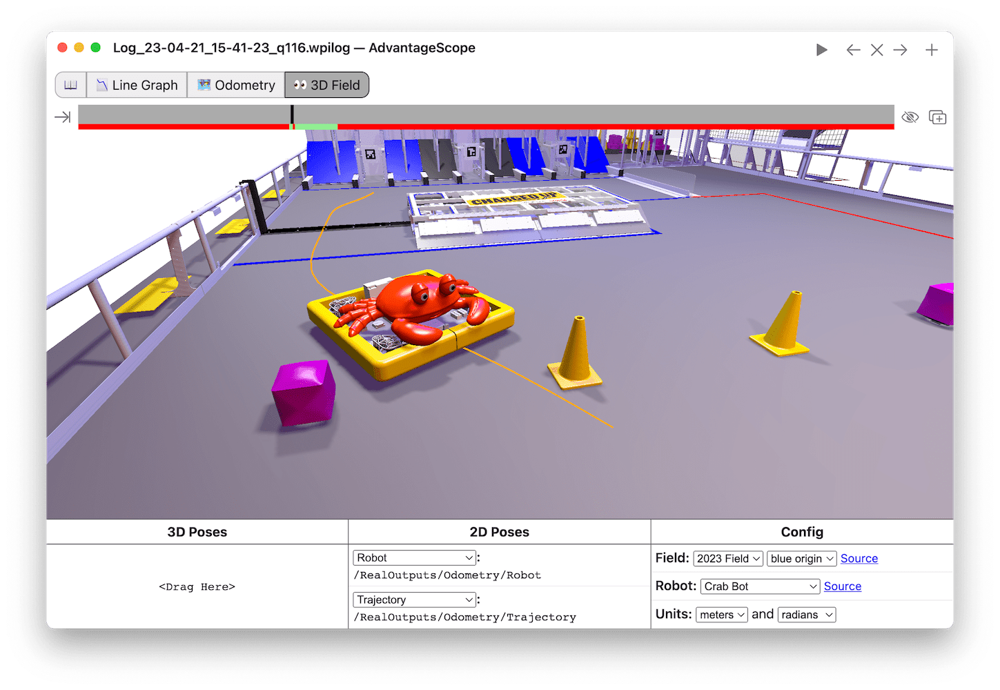

# The Field2d Widget

Glass supports displaying your robot's position on the field using the :guilabel:`Field2d` widget. An instance of the ``Field2d`` class should be created, sent over NetworkTables, and updated periodically with the latest robot pose in your robot code.

## Sending Robot Pose from User Code

Create a ``Field2d`` member, update it with the pose from :ref:`odometry <docs/software/kinematics-and-odometry/intro-and-chassis-velocities:What is odometry?>` or a pose estimator, and log it each periodic cycle using :doc:`Telemetry </docs/software/telemetry/telemetry>`:

.. tab-set-code::
   ```java
   import org.wpilib.smartdashboard.Field2d;
   import org.wpilib.telemetry.Telemetry;

   private final Field2d m_field = new Field2d();

   // In robotPeriodic() or subsystem periodic():
   m_field.setRobotPose(m_odometry.getPoseMeters());
   Telemetry.log("Field", m_field);
   ```

   ```c++
   #include <wpi/smartdashboard/Field2d.hpp>
   #include <wpi/telemetry/Telemetry.hpp>

   wpi::Field2d m_field;

   // In RobotPeriodic() or subsystem Periodic():
   m_field.SetRobotPose(m_odometry.GetPose());
   wpi::telemetry::Log("Field", m_field);
   ```

   ```python
   import telemetry
   from wpilib import Field2d

   # In initialization:
   self.field = Field2d()

   # In robot_periodic() or subsystem periodic():
   self.field.set_robot_pose(self.odometry.get_pose())
   telemetry.log("Field", self.field)
   ```

With the default backend, the field appears at ``/Telemetry/Field``. Updating the pose alone does not send another telemetry sample; log the object after updating it.

## Sending Trajectories to Field2d

Visualizing a trajectory helps verify that it was generated as intended. Add it to a named field object with ``setTrajectory()`` / ``SetTrajectory()`` / ``set_trajectory()``:

.. tab-set-code::
   ```java
   m_field.getObject("traj").setTrajectory(m_trajectory);
   ```

   ```c++
   m_field.GetObject("traj")->SetTrajectory(m_trajectory);
   ```

   ```python
   self.field.get_object("traj").set_trajectory(self.trajectory)
   ```

Set the trajectory when it is created or changed, and continue logging the field periodically as shown above.

## Viewing Trajectories with Glass

The sent trajectory can be viewed with :ref:`Glass <docs/software/dashboards/glass/index:Glass>` through :guilabel:`NetworkTables` -> :guilabel:`Telemetry` -> :guilabel:`Field`.



## Accepting Dashboard Pose Edits

If robot code needs to read poses edited on the dashboard, publish the field once through :doc:`Tunables </docs/software/telemetry/tunables>` instead:

.. tab-set-code::
   ```java
   import org.wpilib.tunable.Tunables;

   // In initialization:
   Tunables.publish("Field", m_field);
   ```

   ```c++
   #include <wpi/tunables/Tunables.hpp>

   // In initialization:
   wpi::tunables::Publish("Field", m_field);
   ```

   ```python
   import tunables

   # In initialization:
   tunables.publish("Field", self.field)
   ```

This field appears at ``/Tunables/Field`` and is updated by the framework. Read an edited pose with the field object's pose getter, such as ``m_field.getObject("Target").getPose()`` in Java. Avoid overwriting that target pose every cycle if the dashboard is meant to control it. Use Telemetry for a field that only displays robot state.

## Viewing the Robot Pose in Glass

After sending the ``Field2d`` instance over NetworkTables, the :guilabel:`Field2d` widget can be added to Glass by selecting :guilabel:`NetworkTables` in the menu bar, choosing the table name that the instance was sent over, and then clicking on the :guilabel:`Field` button.



Once the widget appears, you can resize and place it on the Glass workspace as you desire. Right-clicking the top of the widget will allow you to customize the name of the widget, select a custom field image, select a custom robot image, and choose the dimensions of the field and robot.

## Selecting Field Image

You can choose from an existing field layout using the :guilabel:`Image` drop-down. Or you can select a custom file by setting the :guilabel:`Image` to ``Custom`` and selecting :guilabel:`Choose JSON/image...`. You can choose to either select an image file or a PathWeaver JSON file as long as the image file is in the same directory.  Choosing the JSON file will automatically import the correct location of the field in the image and the correct size of the field.

.. note:: You can retrieve the latest field image and JSON files from [here](https://github.com/wpilibsuite/allwpilib/tree/v2027.0.0-alpha-7/fields/src/main/native/resources/org/wpilib/fields).



## Modifying Pose Style

Poses can be customized in a plethora of ways by right clicking on the Field2d menu bar. Examples of customization are: line width, line weight, style, arrow width, arrow weight, color, etc.



One usage of customizing the pose style is converting the previously shown ``traj`` pose object to a line, rather than a list of poses. Click on the :guilabel:`Style` dropdown box and select :guilabel:`Line`. You should notice an immediate change in how the trajectory looks.



Now, uncheck the :guilabel:`Arrows` checkbox. This will cause our trajectory to look like a nice and fluid line!



## Viewing Pose Data with AdvantageScope

:ref:`AdvantageScope <docs/software/dashboards/advantagescope:AdvantageScope>` is an alternative option for viewing pose data from a ``Field2d`` object, including data recorded to a log file using :ref:`WPILib data logs <docs/software/telemetry/datalog:On-Robot Telemetry Recording Into Data Logs>`. Both 2D and 3D visualizations are supported. See the documentation for the [odometry](https://docs.advantagescope.org/tab-reference/odometry) and [3D field](https://docs.advantagescope.org/tab-reference/3d-field) tabs for more details.


