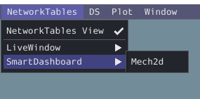
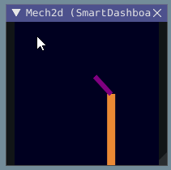
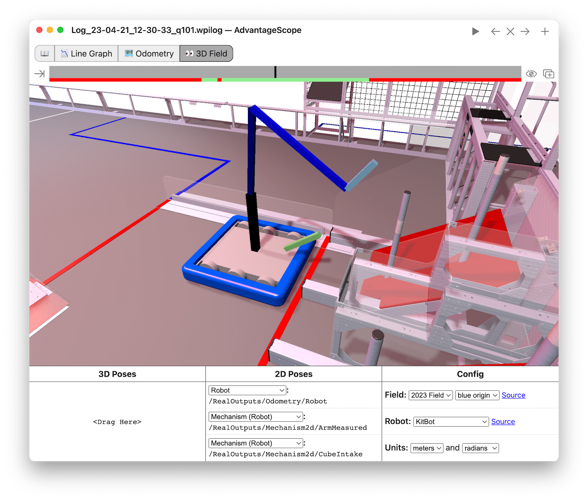

# The Mechanism2d Widget

Glass supports displaying stick-figure representations of your robot's mechanisms using the :guilabel:`Mechanism2d` widget. It supports combinations of ligaments that can rotate and / or extend or retract, such as arms and elevators and they can be combined for more complicated mechanisms. An instance of the ``Mechanism2d`` class should be created and populated, sent over NetworkTables, and updated periodically with the latest mechanism states in your robot code. It can also be used with the :doc:`Physics Simulation </docs/software/wpilib-tools/robot-simulation/physics-sim>` to visualize and program your robot's mechanisms before the robot is built.

## Creating and Configuring the Mechanism2d Instance

The ``Mechanism2d`` object is the "canvas" where the mechanism is drawn. The root node is where the mechanism is anchored to ``Mechanism2d``. For a single jointed arm this would the pivot point. For an elevator, this would be where it's attached to the robot's base. To get a root node (represented by a ``MechanismRoot2d`` object), call ``getRoot(name, x, y)`` on the container ``Mechanism2d`` object. The name is used to name the root within NetworkTables, and should be unique, but otherwise isn't important. The ``x / y`` coordinate system follows the same orientation as ``Field2d`` - ``(0,0)`` is bottom left.

In the examples below, an elevator is drawn, with a rotational wrist on top of the elevator. The full Mechanism2d example is available in [Java](https://github.com/wpilibsuite/allwpilib/blob/v2027.0.0-alpha-7/wpilibjExamples/src/main/java/org/wpilib/examples/mechanism2d/Robot.java) / [C++](https://github.com/wpilibsuite/allwpilib/blob/v2027.0.0-alpha-7/wpilibcExamples/src/main/cpp/examples/Mechanism2d/cpp/Robot.cpp)

.. tab-set-code::

   .. remoteliteralinclude:: https://raw.githubusercontent.com/wpilibsuite/allwpilib/v2027.0.0-alpha-7/wpilibjExamples/src/main/java/org/wpilib/examples/mechanism2d/Robot.java
      :language: java
      :lines: 36-39,43-46
      :linenos:

   .. remoteliteralinclude:: https://raw.githubusercontent.com/wpilibsuite/allwpilib/v2027.0.0-alpha-7/wpilibcExamples/src/main/cpp/examples/Mechanism2d/cpp/Robot.cpp
      :language: c++
      :lines: 56-59
      :lineno-match:

   .. remoteliteralinclude:: https://raw.githubusercontent.com/robotpy/mostrobotpy/2027.0.0a7/examples/robot/Mechanism2d/robot.py
      :language: python
      :lines: 36-39
      :lineno-match:

Each ``MechanismLigament2d`` object represents a stage of the mechanism. It has three required parameters, a name, an initial length to draw (relative to the size of the ``Mechanism2d`` object), and an initial angle to draw the ligament in degrees. Ligament angles are relative to the parent ligament, and follow math notation - the same as :ref:`Rotation2d <docs/software/advanced-controls/geometry/pose:Rotation>` (counterclockwise-positive). A ligament based on the root with an angle of zero will point right. Two optional parameters let you change the width (also relative to the size of the Mechanism2d object) and the color. Call ``append()``/``Append()`` on a root node or ligament node to add another node to the figure. In Java, pass a constructed ``MechanismLigament2d`` object to add it. In C++, pass the construction parameters in order to construct and add a ligament.

.. tab-set-code::

   .. remoteliteralinclude:: https://raw.githubusercontent.com/wpilibsuite/allwpilib/v2027.0.0-alpha-7/wpilibjExamples/src/main/java/org/wpilib/examples/mechanism2d/Robot.java
      :language: java
      :lines: 48-52
      :lineno-match:

   .. remoteliteralinclude:: https://raw.githubusercontent.com/wpilibsuite/allwpilib/v2027.0.0-alpha-7/wpilibcExamples/src/main/cpp/examples/Mechanism2d/cpp/Robot.cpp
      :language: c++
      :lines: 60-65
      :lineno-match:

   .. remoteliteralinclude:: https://raw.githubusercontent.com/robotpy/mostrobotpy/2027.0.0a7/examples/robot/Mechanism2d/robot.py
      :language: python
      :lines: 41-48
      :lineno-match:

## Updating and Logging the Mechanism

To manipulate a ligament angle or length, call ``setLength()`` or ``setAngle()`` on the ``MechanismLigament2d`` object. When using sensor measurements for a ligament's length, add its minimum length to avoid an invisible, zero-length ligament. After updating the mechanism, log it through :doc:`Telemetry </docs/software/telemetry/telemetry>` in every periodic cycle:

.. tab-set-code::

   .. remoteliteralinclude:: https://raw.githubusercontent.com/wpilibsuite/allwpilib/v2027.0.0-alpha-7/wpilibjExamples/src/main/java/org/wpilib/examples/mechanism2d/Robot.java
      :language: java
      :lines: 55-63
      :lineno-match:

   .. remoteliteralinclude:: https://raw.githubusercontent.com/wpilibsuite/allwpilib/v2027.0.0-alpha-7/wpilibcExamples/src/main/cpp/examples/Mechanism2d/cpp/Robot.cpp
      :language: c++
      :lines: 34-42
      :lineno-match:

   .. remoteliteralinclude:: https://raw.githubusercontent.com/robotpy/mostrobotpy/2027.0.0a7/examples/robot/Mechanism2d/robot.py
      :language: python
      :lines: 50-58
      :lineno-match:

Java uses ``org.wpilib.telemetry.Telemetry`` and C++ uses ``<wpi/telemetry/Telemetry.hpp>``. With the default backend, these examples produce ``/Telemetry/Mech2d``. ``Mechanism2d`` implements ``TelemetryLoggable``; changing a ligament does not publish the change until the mechanism is logged again.

## Viewing the Mechanism2d in Glass

After sending the ``Mechanism2d`` instance over NetworkTables, the :guilabel:`Mechanism2d` widget can be added to Glass by selecting :guilabel:`NetworkTables` in the menu bar, choosing :guilabel:`Telemetry`, and then clicking on :guilabel:`Mech2d`.

Once the widget appears as shown below, you can resize and place it on the Glass workspace as you desire. Right-clicking the top of the widget will allow you to customize the name of the widget. As the wrist potentiometer and elevator encoder changes, the mechanism will update in the widget.

## Viewing the Mechanism2d in AdvantageScope

:ref:`AdvantageScope <docs/software/dashboards/advantagescope:AdvantageScope>` is an alternative option for viewing a ``Mechanism2d`` object, including data recorded to a log file using :ref:`WPILib data logs <docs/software/telemetry/datalog:On-Robot Telemetry Recording Into Data Logs>`. Both 2D and 3D visualizations are supported. See the documentation for the [mechanism](https://docs.advantagescope.org/tab-reference/mechanism) and [3D field](https://docs.advantagescope.org/tab-reference/3d-field) tabs for more details.

## Next Steps

As mentioned above, the Mechanism2d visualization can be combined with :doc:`Physics Simulation </docs/software/wpilib-tools/robot-simulation/physics-sim>` to help you program mechanisms before your robot is built. The ArmSimulation ([Java](https://github.com/wpilibsuite/allwpilib/blob/v2027.0.0-alpha-7/wpilibjExamples/src/main/java/org/wpilib/examples/armsimulation/Robot.java) / [C++](https://github.com/wpilibsuite/allwpilib/blob/v2027.0.0-alpha-7/wpilibcExamples/src/main/cpp/examples/ArmSimulation/cpp/Robot.cpp) / [Python](https://github.com/robotpy/examples/blob/2024.0.0b4/ArmSimulation/robot.py)) and ElevatorSimulation ([Java](https://github.com/wpilibsuite/allwpilib/blob/v2027.0.0-alpha-7/wpilibjExamples/src/main/java/org/wpilib/examples/elevatorsimulation/Robot.java) / [C++](https://github.com/wpilibsuite/allwpilib/blob/v2027.0.0-alpha-7/wpilibcExamples/src/main/cpp/examples/ElevatorSimulation/cpp/Robot.cpp) / [Python](https://github.com/robotpy/examples/blob/2024.0.0b4/ElevatorSimulation/robot.py)) examples combine physics simulation and Mechanism2d visualization so that you can practice programming a single jointed arm and elevator without a robot.
