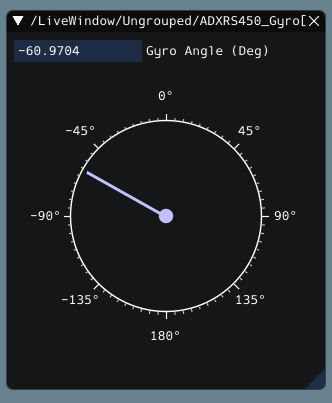
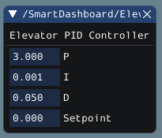
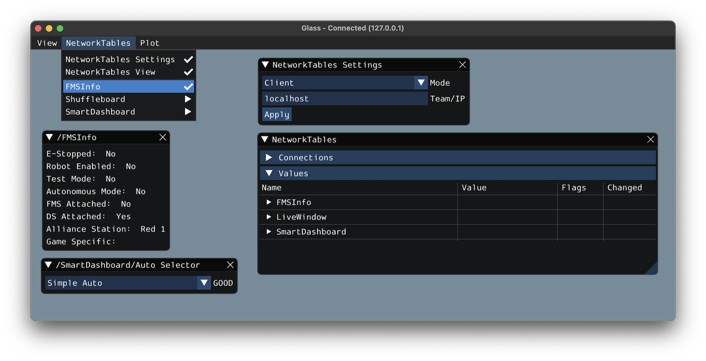

# Glass Widgets

Specialized widgets are available for certain types that exist in robot code. These include objects logged through :doc:`Telemetry </docs/software/telemetry/telemetry>` or published through :doc:`Tunables </docs/software/telemetry/tunables>`, such as ``Selectable`` instances.

.. note:: Widget support in Glass is still in its infancy -- therefore, there are only a handful of widgets available. This list will grow as development work continues.

.. note:: A widget can be renamed by right-clicking on its header and specifying a new name.

## Hardware Widgets

Hardware state must be logged explicitly through Telemetry; it is no longer automatically published through LiveWindow. For a hardware object that implements ``TelemetryLoggable``, log it periodically to expose its supported fields and widget type. Widgets appear under the corresponding path in the :guilabel:`NetworkTables` menu, normally under :guilabel:`Telemetry`.

Here is an example of the widget for gyroscopes:



## Selectable Widget

The :guilabel:`Selectable` widget displays a :doc:`Selectable </docs/software/telemetry/selectable>` from robot code. Add named options and a default, then publish the selectable once during initialization:

.. tab-set-code::
   ```java
   import org.wpilib.tunable.Tunables;

   Tunables.publish("Auto Selector", m_selector);
   ```

   ```c++
   #include <wpi/tunables/Tunables.hpp>

   wpi::tunables::Publish("Auto Selector", m_selector);
   ```

   ```python
   import tunables

   tunables.publish("Auto Selector", self.selector)
   ```

With the default backend, open :guilabel:`NetworkTables` -> :guilabel:`Tunables` -> :guilabel:`Auto Selector`. Robot code reads the chosen option with ``getSelected()`` / ``GetSelected()`` / ``get_selected()``. Use a current Glass version with Selectable support; the old SendableChooser widget uses a different protocol.

## PID Controller Widget

The :guilabel:`PID Controller` widget allows you to quickly tune PID values for a certain controller. Publish the ``PIDController`` instance through Tunables once during initialization:

.. tab-set-code::
   ```java
   Tunables.publish("Elevator PID Controller", m_elevatorPIDController);
   ```

   ```c++
   wpi::tunables::Publish("Elevator PID Controller", m_elevatorPIDController);
   ```

   ```python
   import tunables

   tunables.publish("Elevator PID Controller", self.elevator_pid_controller)
   ```

Open the controller under :guilabel:`NetworkTables` -> :guilabel:`Tunables` to tune P, I, and D values for various setpoints. To display controller state without allowing edits, log the controller periodically through Telemetry instead.



## FMSInfo Widget

The :guilabel:`FMSInfo` widget is created by default when Glass connects to a robot. This widget displays basic information about the robot's enabled state, whether a Driver Station is connected, whether an :term:`FMS` is connected, the game-specific data, etc. It can be viewed by selecting the :guilabel:`NetworkTables` menu item and clicking on :guilabel:`FMSInfo`.


